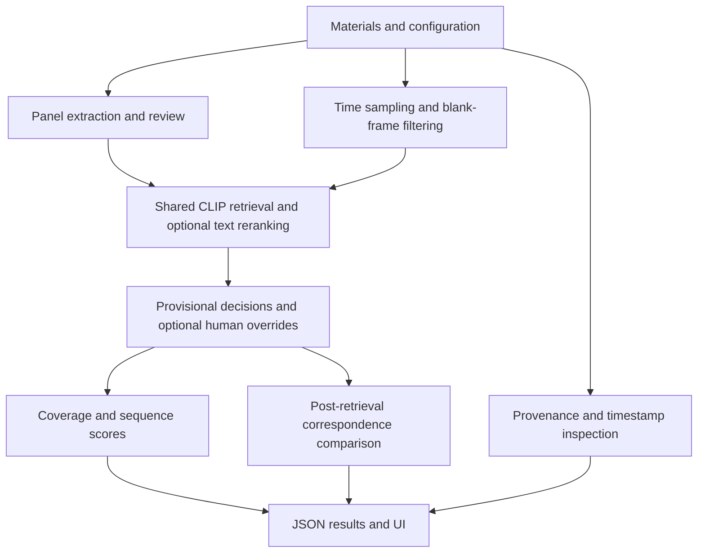

# Architecture and API

The React frontend submits work to `web_server.py`; Starlette endpoints call shared Python modules. Heavy jobs use a single background worker with polling. The notebook and CLI use the same package. The frontend displays results and submits corrections; it does not independently run CLIP or calculate backend evidence scores.

## Module map
| File | Responsibility |
|---|---|
| `web_server.py` | Local API, jobs, uploads, media, downloads, cache clearing |
| `frontend/` | React, shadcn/ui and Radix interface |
| `streamlit_app.py` | Alternative Streamlit interface |
| `run_demo.py` | CLI execution and review overrides |
| `src/cs55_demo/system.py` | Shared orchestration, retrieval, aggregation and scoring |
| `automatic.py` | Quality filters, selection rules and declaration helpers |
| `sampling.py` | Time-based video sampling |
| `storyboard_layout.py` | PDF region detection |
| `storyboard_text.py` | Description extraction and text groups |
| `dual_retrieval.py`, `local_structure.py` | Structural features and diagnostics |
| `provenance.py`, `source_project.py` | Evidence extraction and project verification |
| `provenance_scoring.py` | Independent provenance and timestamp rubrics |

Module names in this table are relative to `src/cs55_demo/` unless a different directory is shown.

## API surface
- `GET /api/bootstrap`: local application state.
- `POST /api/prepare`: prepare materials.
- `POST /api/upload/{role}` and `/api/choose-file`: material input.
- `GET /api/jobs/{job_id}`: job progress.
- `GET /api/runs/{run_id}`: run details.
- `POST /api/runs/{run_id}/panel-review`, `/ranges`, `/match`, `/provenance`, `/reviews`: workflow actions.
- `GET /api/runs/{run_id}/media` and `/download/{name}`: previews and outputs.
- `POST /api/cache/clear`: delete generated outputs.

These are local application endpoints, not a versioned public API. Consult handler code for request payloads. The default server binds to `127.0.0.1:8505`; local file paths refer to that machine.

---
[Wiki Home](Home.md) · Documentation snapshot: 29 October 2026
